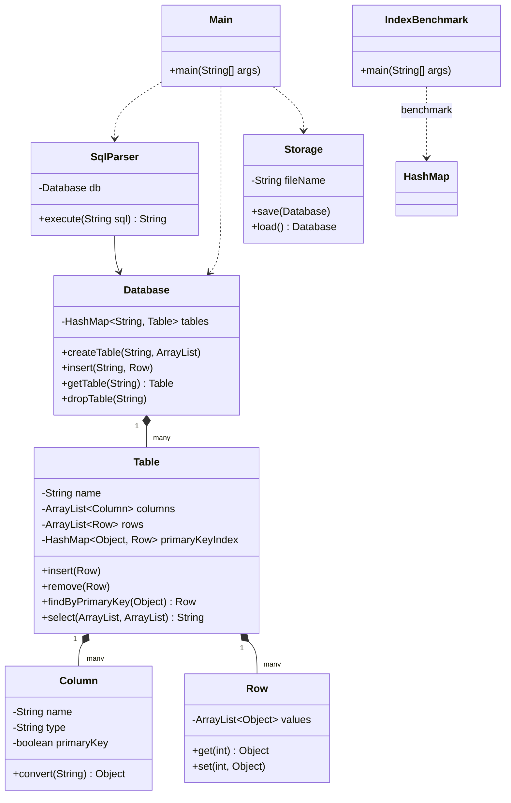
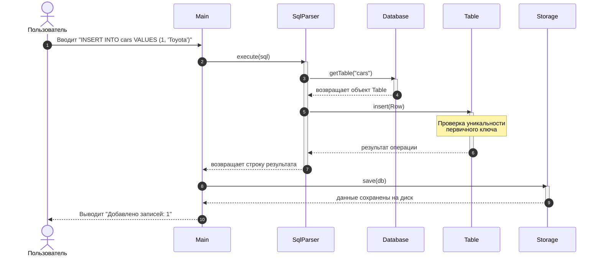

# Лабораторная работа № 2

## Разработка простой системы управления базами данных на Java

**Участники:** Пыслярь Полина, Поликарпова Дарья

------------------------------------------------------------------------

## 1. Архитектура системы

Программа реализована на Java и состоит из нескольких классов, каждый из
которых отвечает за отдельную часть работы с базой данных.

### Основные компоненты

  -----------------------------------------------------------------------
  Класс                               Назначение
  ----------------------------------- -----------------------------------
  `Main`                              Консольный интерфейс и управление
                                      работой программы

  `Database`                          Управление таблицами, проверка
                                      связей и ограничений

  `Table`                             Хранение записей, выполнение
                                      операций с таблицами и работа с
                                      индексом

  `Column`                            Описание столбцов и преобразование
                                      типов данных

  `Row`                               Хранение значений одной записи

  `SqlParser`                         Разбор и выполнение SQL-команд

  `Storage`                           Сохранение и загрузка базы данных

  `IndexBenchmark`                    Сравнение скорости поиска с
                                      индексом и без него
  -----------------------------------------------------------------------

### Диаграмма классов

Диаграмма показывает основные классы и связи между ними.



### Диаграмма последовательностей

Пример обработки SQL-запроса `INSERT` (вставка записи) от момента ввода пользователем до сохранения на диск.



## 2. Сравнение поиска с индексом и без индекса

Для оценки эффективности индекса был проведён тест с использованием 100 000 целочисленных значений и 20 000 поисковых операций.

В тесте сравнивались два способа поиска:

- **Без индекса** — последовательный перебор элементов массива до нахождения нужного значения.
- **С индексом** — поиск значения по ключу с использованием `HashMap`.

### Результаты тестирования

По результатам запуска программы получены следующие значения:

| Показатель | Результат |
|---|---:|
| Количество записей | 100 000 |
| Количество поисковых операций | 20 000 |
| Время поиска без индекса | 203,2764 мс |
| Время поиска с индексом | 4,2579 мс |
| Ускорение поиска | 47,7 раза |

Таким образом, в данном тесте поиск с использованием `HashMap` оказался примерно в 47,7 раза быстрее последовательного перебора массива.

Контрольные суммы обоих способов поиска совпали: `1008266285`. Это подтверждает, что оба алгоритма обработали одинаковый набор поисковых значений и получили одинаковый результат.

**Вывод:** использование индекса позволяет существенно сократить время поиска данных. Без индекса программа последовательно проверяет элементы массива, тогда как `HashMap` обеспечивает быстрый доступ к значению по ключу. Полученные результаты демонстрируют преимущество индексированного поиска на тестовом наборе данных.


## 3. Инструкция пользователя

### Запуск программы

Для работы необходима Java 8 или более поздняя версия.

1.  Открыть папку проекта.
2.  Открыть терминал в папке с Java-файлами.
3.  Скомпилировать исходный код:

``` bash
javac *.java
```

4.  Запустить программу:

``` bash
java Main
```

При первом запуске создаётся новая база данных. При последующих запусках
программа загружает сохранённые данные из файла `data/database.ser`.

### Консольное меню

После запуска доступны три пункта:

1.  Выполнить SQL-запрос.
2.  Показать таблицы.
3.  Выход.

### Примеры SQL-команд

**Добавление записи:**

``` sql
INSERT INTO cars (id, brand, price, available) VALUES (1, 'BMW', 25000, true);
```

**Вывод всех записей:**

``` sql
SELECT * FROM cars;
```

**Поиск по условию:**

``` sql
SELECT * FROM cars WHERE id = 1;
```

**Изменение записи:**

``` sql
UPDATE cars SET price = 30000 WHERE id = 1;
```

**Удаление записи:**

``` sql
DELETE FROM cars WHERE id = 1;
```

**Создание таблицы:**

``` sql
CREATE TABLE products (id INT PRIMARY KEY, name STRING, price DOUBLE);
```

**Удаление таблицы:**

``` sql
DROP TABLE products;
```

SQL-команды вводятся целиком в одну строку после приглашения `SQL>`.

### Поддерживаемые типы данных

  Тип         Описание                   Пример
  ----------- -------------------------- ----------------
  `INT`       Целое число                `10`
  `DOUBLE`    Число с плавающей точкой   `125.50`
  `STRING`    Строка                     `'BMW'`
  `DATE`      Дата                       `'2026-11-14'`
  `BOOLEAN`   Логическое значение        `true`

В системе предусмотрены первичные и внешние ключи, а также проверка
уникальности первичного ключа и ссылочной целостности.

## 4. Распределение обязанностей

| Участник | Область ответственности |
|---|---|
| Пыслярь Полина | Разработка классов `Column`, `Row`, `Table` и `Database`: описание структуры таблиц и типов данных, хранение записей, проверка ограничений и работа с индексом первичного ключа. Подготовка сравнительного теста поиска с индексом и без него (`IndexBenchmark`). |
| Поликарпова Дарья | Разработка `SqlParser`, `Storage` и `Main`: разбор и выполнение SQL-команд, сохранение и загрузка базы данных, реализация консольного меню и взаимодействия пользователя с программой. |
| Совместная работа | Проверка работы программы, тестирование SQL-запросов, подготовка README и итоговая проверка проекта. |

## 5. Выводы

В ходе лабораторной работы разработана простая система управления базами
данных на Java.

Реализованы создание таблиц, добавление, изменение, удаление и выборка
записей с использованием SQL-команд. Предусмотрены поддержка основных
типов данных, первичные и внешние ключи, проверка целостности данных и
сохранение базы на диске.

Проведённое тестирование показало, что использование индекса значительно
сокращает время поиска по сравнению с последовательным перебором
записей.

## 6. Использованные источники

1. Учебные материалы курса «Программирование на языке Java» (лекции 1–8).
2. Oracle. The Java Tutorials. https://docs.oracle.com/javase/tutorial/
3. Baeldung. Time Complexity of Java Collections. https://www.baeldung.com/java-collections-complexity
4. LogicBig. Java Collection Interfaces and Implementations. https://www.logicbig.com/tutorials/core-java-tutorial/java-collections/java-collection-cheatsheet.html

